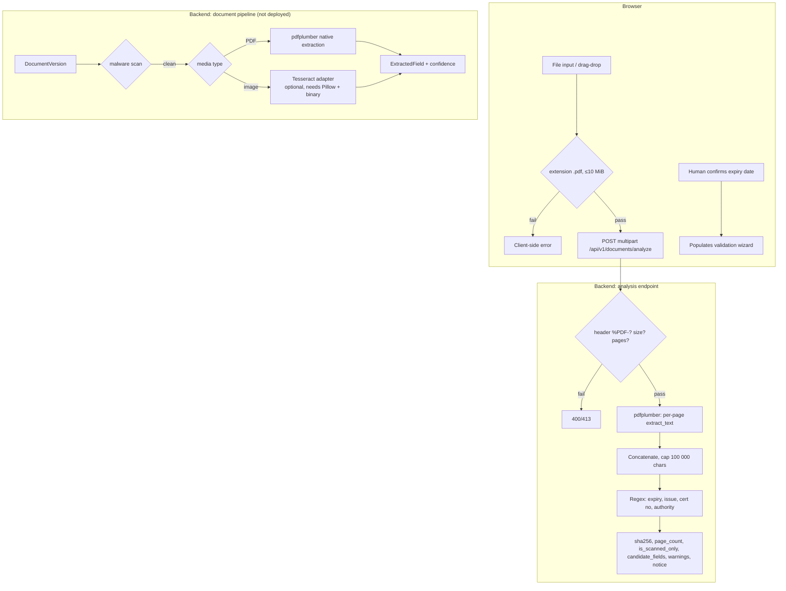

# AI, OCR and Intelligent Processing

**Headline finding: there is no AI model in this system.** No LLM, no classifier, no
embeddings, no fine-tuned model, no external AI provider. A repository-wide search for
`openai|anthropic|gemini|llm|gpt|langchain` across `backend/app` and `frontend/app/src` returns
exactly one hit, and it is the substring "llm" inside the Python builtin `re.fullmatch`.

Everything marketed as "AI" in the interface is one of:

1. **Deterministic set arithmetic and date comparison** (the actual validation).
2. **Regex-based field extraction** from PDF text.
3. **Optional Tesseract OCR** for images, which is not installed in any deployed environment.
4. **Hardcoded JavaScript heuristics** presented with probability-like labels.
5. **Mock data** for demonstration screens.

This document separates those four honestly, because a judge or interviewer will ask.

---

## 1. Processing architecture at a glance



---

## 2. Text extraction (implemented, real)

| Property | Value |
|---|---|
| Library | `pdfplumber>=0.11,<1.0` (`backend/requirements.txt`) |
| Function | `analyze_pdf_document()` in `backend/app/document_analyzer.py` |
| Limits | 10 MiB, 100 000 characters, all pages |
| Output | `filename`, `filesize_bytes`, `sha256`, `page_count`, `is_scanned_only`, `extracted_text_preview` (2 000 chars), `candidate_fields`, `warnings`, `notice` |
| Storage | **None** — bytes are processed in memory and discarded |
| Failure modes | non-PDF (400), empty (400), oversize (413), missing `%PDF-` header (400), unreadable/encrypted (400), zero pages (400) |

**Scanned-document handling.** If the concatenated text is shorter than 30 characters, the
result is flagged `is_scanned_only: true` with the warning *"Document appears to be scanned or
image-only without selectable text."* No OCR is attempted on this endpoint. A scanned fire NOC
therefore returns **no candidate fields** — which is the correct, honest behaviour but is
often mistaken for a bug during demos.

**Truncation.** Extraction stops at 100 000 characters and adds a warning. Fields are matched
against the text extracted *before* the cap, so a certificate whose dates appear after
100 000 characters will not be found. In practice this only affects very long bundles.

**Contract drift between the repo and the live deployment.** The repository returns
`extracted_text_preview` and a flat `candidate_fields`. The live backend returns
`extracted_text` and a nested `fields{}` with `{value, confidence, page_number, evidence_text}`.
Both include `sha256`, `page_count`, `warnings`, `notice`; the live one adds
`requires_human_review` and omits `is_scanned_only`.

Observed live test (2026-10-30) with a generated one-page PDF containing
"Valid until 14/04/2027" and "Certificate No: NOC/DFS/MUM/2024/8912":

```json
{
  "filename": "synthetic_fire_noc.pdf",
  "sha256": "c9f458bd…895be",
  "page_count": 1,
  "extracted_text": "[Page 1]\nFIRE SAFETY CERTIFICATE\n… Valid until 14/04/2027",
  "fields": {
    "certificate_number": {
      "value": "NOC/DFS/MUM/2024/8912",
      "confidence": null,
      "page_number": 1,
      "evidence_text": "Certificate No: NOC/DFS/MUM/2024/8912"
    }
  },
  "warnings": ["PDF contents are processed for this request only and are not stored by this endpoint."],
  "requires_human_review": true,
  "notice": "Advisory extraction only. … A qualified reviewer must compare every result with the original document."
}
```

Two facts follow: extraction is genuinely running in production, and **the expiry date was
missed even though the phrase "Valid until 14/04/2027" was present**. The live extractor's date
patterns are narrower than the repository's. Never treat a null `expiry_date` as evidence that
the certificate has no expiry.

---

## 3. Field extraction (implemented, regex)

`_extract_candidates()` looks for:

| Field | Patterns accepted | Normalisation |
|---|---|---|
| `expiry_date` | `valid until / valid up to / valid upto / valid till / expiry date / expires on` + date | `YYYY-MM-DD`, `DD-MM-YYYY`, `DD/MM/YYYY`, `DD.MM.YYYY` → ISO |
| `issue_date` | `date of issue / issued on / issue date / dated` + date | same |
| `certificate_number` | `ref no / reference no / cert no / certificate number / noc no` + 4–40 chars of `[A-Z0-9/_-]` | trimmed |
| `issuing_authority` | keyword families: fire services, structural/municipal, sub-registrar/revenue, AICTE | **mapped to a fixed label**, not the literal text |

**Normalisation risk.** `05/03/2026` is inherently ambiguous; the code resolves it as
`DD-MM-YYYY` (day first), which is correct for Indian certificates but silently wrong for a
US-formatted document. There is no confidence signal on date format ambiguity.

**Authority mapping risk.** The returned authority is a *canonical label chosen by regex*, e.g.
any mention of "Municipal Corporation" yields `"Municipal Structural Stability Authority"` even
if the sentence was about water tax. It is a hint, not an extracted fact.

**No authenticity check.** `sha256` is computed over the uploaded bytes so a reviewer can
confirm the same file was analysed later. It does **not** prove the document is genuine, and
nothing is compared against an issuer's registry.

---

## 4. OCR (implemented, optional, not installed anywhere)

| Property | Value |
|---|---|
| Contract | `backend/app/ocr_adapter.py` — `OCRAdapter` protocol, `OCRField`, `OCRDocumentResult` |
| Adapter | `TesseractOCRAdapter` in `backend/app/ocr_pipeline.py` |
| Dependencies | **separate** file `backend/requirements-ocr.txt` (`Pillow==11.3.0`, `pytesseract==0.3.13`) + the Tesseract system binary |
| Formats | JPEG, PNG, TIFF, WEBP (magic-byte validated) |
| Pre-processing | grayscale, autocontrast, upscale if the short edge is < 700 px (capped at 2× and 30 MP) |
| Confidence | per-word Tesseract 0–100 % converted to 0–1; non-finite or out-of-range values are **dropped, never clamped** |
| Guard rails | `requires_human_review` is forced `true` — constructing a result with `False` raises |

Because `pytesseract` is deliberately excluded from `backend/requirements.txt`, the pipeline
falls back to `engine = None` and appends *"OCR system engine is not installed on host; text
extraction skipped."* This is exactly what produces the single failing test in a fresh
environment (`test_…` expecting OCR output), and it means **the Render backend does not OCR
anything**. That is a configuration choice, not a bug, but it must not be described as
working OCR.

There is also `backend/app/ocr_cli.py`, a local-only CLI for running the adapter against one
image, documented as advisory.

---

## 5. What the UI calls "AI" — and what it really is

| UI label | Reality | Where |
|---|---|---|
| "Nil-Deficiency **Smart Gap Predictor**" | Deterministic percentage from submitted ÷ required, minus fixed penalties | `computeReadinessScore`, `lib/aicte-rules.ts` |
| "Probability of Nil-Deficiency" | **Not a probability.** No model, no calibration, no training data | `NilDeficiencyGapPredictor.tsx` |
| "Document Authenticity & Extraction Assistant" | `pdfplumber` text + regex; no authenticity logic | `DocumentOcrVerifier.tsx` |
| "Sample Benchmarks" with 94–98 % confidence | **Hardcoded mock objects** (`OCR_SAMPLES`) with invented cert numbers and SHA-256 strings | same file |
| "Regulatory Scrutiny Decision-Support Workbench" | `simulated_demo_adapter`; synthetic result path | `RegulatoryScrutinyWorkbench.tsx` |
| "AI-assisted / intelligent scrutiny" | No model is invoked at any point | — |

### 5.1 The readiness formula, exactly

```
total          = len(required) or 1
validSubmitted = count(submitted ∩ required) − expiredCount
rawScore       = round(validSubmitted / total × 100)
rawScore      -= 18 × criticalZeroToleranceCount
rawScore      -= 5  × expiringSoonCount      # ≤ 60 days
score          = clamp(rawScore, 0, 100)

tier = ready_nil_deficiency      if score ≥ 95 and no critical and no expired
       conditional_minor_hearing if score ≥ 65
       critical_deficiency_risk  otherwise
```

**Defect.** `criticalZeroToleranceCount` is computed by looking up
`APH_CLAUSE_CATALOG[documentName]`, but the catalog is keyed by display labels
(`"Fire Safety Certificate"`) while the calculator receives form IDs
(`"fire_safety_certificate"`). Every lookup miss sets `isStatutoryZeroTolerance = false`, so
the −18 penalty and the clause/impact/mitigation text never apply. Observed live: two
zero-tolerance documents missing → 40 %, where the intended formula gives 22 %.

### 5.2 The expiry heuristic

Client-side: `diffDays = ceil((expiry − now) / 86400000)` on the browser clock; expired if
`< 0`, "expiring soon" if `≤ 60`. Server-side: expired if `expiry < today(UTC)`. Two different
clocks and two different operators; results can disagree by one day around midnight and for
documents expiring today.

---

## 6. Confidence: what the numbers mean

| Number | Source | Meaning |
|---|---|---|
| Extraction confidence (0–1) | OCR adapter per word, or native-PDF heuristic | Only used in Pipeline B to flag `< 0.60` fields for review |
| `94.2`, `97.4`, `98.6` | `OCR_SAMPLES` constants | **Fabricated.** No computation, no measurement, no test set |
| Readiness 0–100 | Heuristic formula | Not a probability; not validated against outcomes |
| "3 findings" | Server count | Real |

There is no accuracy metric for extraction anywhere in the repository: no labelled document
set, no precision/recall, no confusion matrix. Any accuracy claim would be unsupported.

---

## 7. Fallbacks and failure behaviour

| Failure | Behaviour | Assessment |
|---|---|---|
| LLM unavailable | N/A — no LLM | — |
| OCR dependencies missing | warn, skip extraction, continue | Correct fail-open for *advisory* data |
| Malware scanner unavailable | `scan_unavailable`, document stays quarantined, validation returns `processing_incomplete` | Correct fail-closed |
| PDF text extraction exception | per-page catch, warning, partial text | Reasonable |
| Analyze response schema mismatch (repo client ↔ live API) | `analysisResult.candidate_fields` is undefined; panel shows no extracted fields | Silent-looking empty state; must be fixed by aligning the contract |
| Workbench API unreachable | **fabricates** `fallbackAttempt` and shows a result | **Risky** — must be labelled synthetic; verify the banner before demoing |
| Client network failure on `/validate` | error alert, no result | Correct |

---

## 8. Current capability vs planned capability

| Capability | Status |
|---|---|
| Native PDF text extraction with page count and hash | ✅ implemented and **live** (`200` on `/documents/analyze`) |
| Regex extraction of dates, certificate numbers, authority hints | ✅ implemented |
| Human-in-the-loop expiry confirmation | ✅ implemented in wizard |
| Image OCR via Tesseract | ⚠️ implemented but not installed; not deployed |
| OCR confidence gating | ✅ implemented (Pipeline B) |
| Document authenticity / forgery detection | ❌ not implemented |
| Issuing-authority API verification | ❌ not implemented (adapter interface + mock only) |
| LLM summarisation, Q&A over handbook, clause reasoning | ❌ **not planned in code either** — no provider, key, or SDK |
| Trained classifier for deficiency risk | ❌ not implemented; the "probability" label overstates a heuristic |

---

## 9. Honest one-liner for presentations

> "We deliberately do not use an LLM. Compliance decisions must be reproducible and
> explainable, so validation is deterministic set and date logic, with regex extraction and an
> optional OCR adapter. What we call 'intelligence' is the rule and clause knowledge base, not
> a model. The one place a model might help — reading scanned certificates — is wired but not
> enabled, and we say so."

---

## 10. If OCR were to be enabled (next steps)

1. Add `backend/requirements-ocr.txt` to the Render build and install `tesseract-ocr` (and
   `tesseract-ocr-eng`) via the platform's apt hook or a custom Docker image.
2. Route PDFs through `pdfplumber` first, falling back to page rasterisation + Tesseract only
   when `is_scanned_only` is true.
3. Expose the OCR endpoint on the deployed backend and add an integration test with a
   committed, non-sensitive sample scan.
4. Keep `requires_human_review = true` and record engine name/version with every field.
5. Build a small labelled set (20–30 synthetic certificates) before quoting any accuracy.
