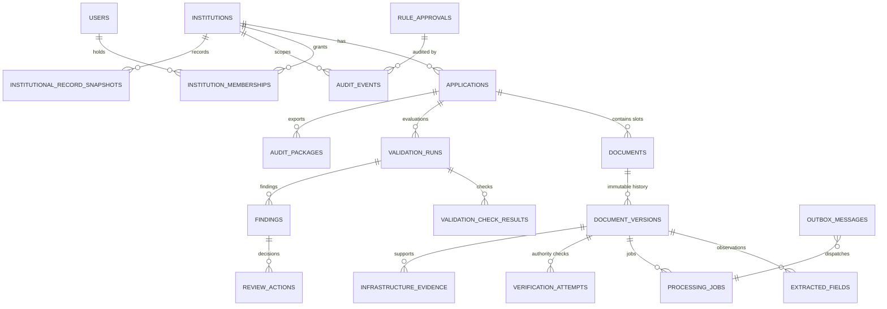
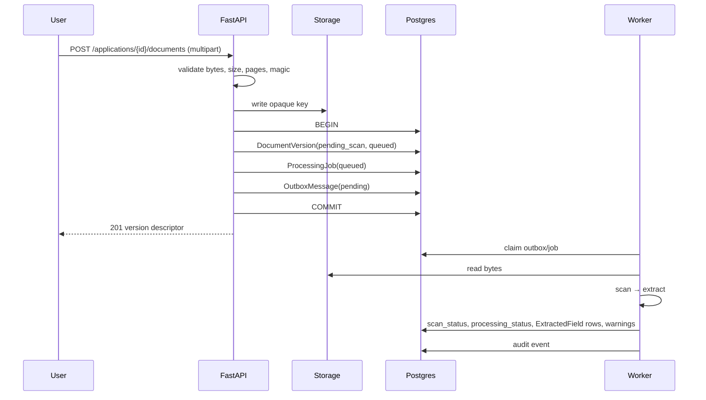

# Database and Data Flow

Schema source: `backend/app/db/models.py` (817 lines, **20 tables**).
Migrations: `backend/alembic/versions/` — **9 revisions**, head `i9d0e1f2a3b4`.

> Verified vs claimed: everything below comes from the SQLAlchemy models and migration files.
> Where a claim exists only in documentation, it is marked. The deployed Render database is on
> revision `g7b8c9d0e1f2`, **two revisions behind the repository head**, so the tables added by
> the last two migrations — `verification_attempts`, `institutional_record_snapshots`,
> `infrastructure_evidence`, `rule_approvals`, `retention_runs` — are not present there yet.

---

## 1. Entity map

---

## 2. Tables

### 2.1 Tenancy and identity

| Table | Key columns | Purpose | Notes |
|---|---|---|---|
| `institutions` | `id`, `institution_id` (unique string), `display_name`, `status`, `created_at` | Tenant root | `institution_id` is the human/AICTE-style identifier; `id` is the FK target |
| `applications` | `id`, `institution_id` FK, `application_type`, `academic_year`, `status`, timestamps | One submission cycle | `status` default `draft`; type ∈ `eoa`, `new_program`, `intake_change` |
| `users` | `id`, `username` (unique), `password_hash`, `is_active`, timestamps | Login identity | bcrypt hash; no email, no reset token, no MFA columns |
| `institution_memberships` | `user_id`, `institution_id`, `role`, `is_active` | Tenant + role grant | Unique per (user, institution) |

### 2.2 Documents and processing

| Table | Key columns | Purpose | Notes |
|---|---|---|---|
| `documents` | `application_id`, `document_type`, `current_version_id` | Logical slot ("fire NOC") | Unique `(application_id, document_type)`; exactly one current version |
| `document_versions` | `document_id`, `version_number`, `storage_key` (unique), `sha256`, `media_type`, `byte_size`, `page_count`, `file_name`, `scan_status`, `processing_status`, `uploaded_at` | Immutable file metadata | Unique `(document_id, version_number)`; bytes live in storage, never in the DB |
| `extracted_fields` | `document_version_id`, `field_name`, `raw_value`, `normalized_value`, `confidence`, … | Advisory observations | Human corrections create new rows/audit events rather than rewriting history |
| `processing_jobs` | `document_version_id`, `status`, `attempts`, `last_error`, timestamps | Worker state | Statuses include `queued`, `scanning`, `extracting`, `retry_wait`, `succeeded`, `partial`, `failed` |
| `outbox_messages` | aggregate/job reference, `status`, `attempts`, `available_at` | Transactional job dispatch | Guarantees a committed upload is eventually processed |

### 2.3 Validation and review

| Table | Key columns | Purpose |
|---|---|---|
| `validation_runs` | `application_id`, `evaluation_date`, `ruleset_version`, `status`, `outcome`, `triggered_by`, `consumed_version_ids`, `rule_snapshot`, `summary_counts`, `limitations`, `completed_at` | Reproducible snapshot of one scrutiny execution |
| `validation_check_results` | `validation_run_id`, `check_id`, `check_name`, `category`, `status`, `document_version_id`, `message`, `evidence`, `limitations` | One row per check considered |
| `findings` | `validation_run_id`, `document_version_id`, `code`, `severity`, `summary`, `evidence`, `review_status` | Actionable deficiencies |
| `review_actions` | `finding_id`/`application_id`, `actor_id`, `action`, `rationale`, timestamp | Human adjudication trail |

`validation_runs` is the heart of traceability: `consumed_version_ids` records exactly which
file versions were read, and `rule_snapshot` records the rules, checklist source, application
type and evaluation date. A later upload cannot retroactively change an old run.

### 2.4 Audit, verification, governance

| Table | Purpose |
|---|---|
| `audit_events` | Append-only event log (`VALIDATION_RUN_COMPLETED`, `REGULATORY_RULE_APPROVED`, …), institution-scoped |
| `audit_packages` | Sealed exports with manifest/hash chain for offline verification |
| `verification_attempts` | Outbound issuing-authority verification attempts (adapter, result, evidence) |
| `institutional_record_snapshots` | Point-in-time institutional data used for comparison |
| `infrastructure_evidence` | Infrastructure observations tied to document versions/applications |
| `rule_approvals` | Durable source-verification + approval records that gate rule activation |
| `retention_runs` | Retention enforcement history (dry-run or live) |

---

## 3. What is stored vs not stored

| Data | Stored? | Where |
|---|---|---|
| Institution identity, applications, memberships | ✅ | Postgres |
| Document **bytes** | ✅ (repo backend) / ephemeral | Private storage directory (`STORAGE_LOCAL_DIR`), key `docs/xx/<uuid>` |
| Document hash, size, page count, media type | ✅ | `document_versions` |
| Extracted field values + confidence | ✅ | `extracted_fields` |
| Validation runs, checks, findings, review actions | ✅ | Postgres |
| Remediation plans and task progress | ✅ (repo backend) | Postgres `remediation_plans`, `remediation_tasks`, scoped by `institution_id` |
| Remediation progress, offline fallback | ⚠️ | Browser `localStorage` key `aicte.actionPlans.v1` when signed out or the API is unreachable |
| Deadline policy (P1/P2/expiry buffer) | ✅ | `remediation_plans.deadline_policy` JSON text; also cached per browser in `aicte.deadlinePolicy.v1` |
| Deadline-policy change history | ✅ (repo backend) | Append-only `remediation_deadline_changes` (previous/new policy, actor, tasks moved, timestamp); also written to `audit_events` as `remediation_deadline_policy_changed` |
| Audit events and sealed packages | ✅ | Postgres + generated archives |
| Passwords | ✅ hash only | bcrypt in `users.password_hash` |
| JWTs | ❌ server-side | Client `sessionStorage`; server stateless |
| API keys / provider secrets | ❌ | Environment only |
| Raw OCR text | ❌ (only preview in response) | Not persisted |
| Public `/validate` inputs | ❌ in Postgres; ⚠️ in a process-global list if the user saves (repository code only; the live backend requires auth and Render does not expose the route) | `_SAVED_RUNS` in `main.py` |
| Frontend history fallback | ⚠️ | Browser `localStorage` key `aicte_local_validation_runs_v1` |
| Analytics / telemetry | ❌ | No analytics SDK anywhere |

**Ephemeral storage risk.** `core/storage.py` is a local-filesystem backend. On Render's free
plan the disk is ephemeral: uploaded documents disappear on redeploy or restart while their
`document_versions` rows remain, producing download 404s against valid metadata. Production use
requires object storage (S3/R2/GCS) or a persistent disk.

---

## 4. Write path: upload → extraction

Ordering guarantees: bytes are written before the row; the row and outbox message commit
together; the worker never sees an uncommitted version; a crash leaves the job claimable.

---

## 5. Read path: validation snapshot

1. Load application and all `documents` for it.
2. Resolve each slot's `current_version` (or the highest `version_number`).
3. Classify: **eligible** (`scan_status=clean` and `processing_status in (succeeded, partial)`),
   **pending**, **rejected**, **failed**.
4. Load gate-approved `rule_approvals`, activate into the in-process registry.
5. Determine checklist source (`caller_specified`, `synthetic_demo`, `default`).
6. Run checks A–H, creating `validation_check_results` and `findings`.
7. Compute counts and outcome; persist run with snapshot, versions consumed, limitations.
8. Append `VALIDATION_RUN_COMPLETED` audit event; commit.

Reads are tenant-scoped before any of this: `verify_institution_membership()` is called on the
application's institution, and foreign tenants get 404.

---

## 6. Audit history retrieval

Two unrelated mechanisms share the name "history":

| Mechanism | Storage | Auth | Lifetime | Used by |
|---|---|---|---|---|
| **Prototype saved runs** | `_SAVED_RUNS` list in the API process (repository code) | **none in `main`**; live variant returns 401 | Until restart | `/history` page (falls back to `localStorage` when the API refuses) |
| **Enterprise validation runs** | Postgres (`validation_runs` + checks + findings) | Bearer + tenant | Permanent until retention | No UI |

The UI's `history-storage.ts` tries the server first (with a token) and falls back to
`localStorage`. Because the live backend has no auth endpoint, the production `/history` page
cannot reach either server path; it would only show runs saved locally in that browser.

---

## 7. Retention and deletion

`retention_service.py` implements policy-driven purging:

| Parameter | Default | Meaning |
|---|---|---|
| `RETENTION_QUARANTINE_DAYS` | 30 | Keep quarantined/rejected files this long before purge |
| `RETENTION_JOB_DAYS` | 14 | Purge old processing job rows |
| `RETENTION_SCHEDULE_INTERVAL_SECONDS` | 86400 | Scheduler cadence |
| `ENABLE_INPROCESS_RETENTION_SCHEDULER` | false | In-process scheduler (dev only) |

`POST /api/v1/compliance/retention/purge` accepts a dry-run flag, is permission-gated, and
writes a `retention_runs` row. **No retention policy is configured in either deployment**, and
the scheduler is off, so nothing is currently purged automatically.

**Deletion semantics.** There is no user-facing "delete my data" endpoint and no cascading
account deletion. Deleting an application cascades to documents/versions/checks/findings in the
DB (`ondelete="CASCADE"`), but the **stored files are not removed by the ORM cascade** — a
storage-level cleanup step is required. Do not claim GDPR-style erasure.

For the public comparison path, nothing is stored by the server; the browser keeps a copy only
if the user elects to save the run.

---

## 8. Data-quality observations

1. **No unique constraint on `(application_id, evaluation_date)`** — repeated validations create
   multiple runs (intended) but there is no dedupe if a UI retries.
2. **`document_type` is a free string with no FK to a document catalog** — a typo creates a new
   slot rather than failing.
3. **`academic_year` is a free string** (`String(20)`); the rule applicability matcher contains
   normalisation for `2026-2027` vs `2026-27`, which is a symptom of unconstrained input.
4. **`status` and `role` are strings**, not DB enums; validation happens in Python.
5. **`sha256` is indexed but not unique** — duplicates are detected by query, which is correct
   (the same certificate may legitimately appear in two institutions? no — that is flagged).
6. **No soft-delete columns** on core entities; deletions are physical.
7. **Timestamps are timezone-aware** (`DateTime(timezone=True)`, `_utc_now`); expiry comparison
   uses `date` values, so the edge case is "expires today".
8. **`page_count` is nullable**; checks must not assume it exists.

---

## 9. Backup and recovery

No backup configuration exists in the repository. Render's managed Postgres free tier provides
platform-level snapshots per Render's terms, not something this project controls or documents.
`render.yaml` does not configure backups. A production deployment needs an explicit backup and
restore test; neither exists today.

---

## 10. Migrations

| Revision | Purpose |
|---|---|
| `80f49ac7e2e2` | Initial persistence foundation |
| `91a2b3c4d5e6` | Auth and memberships |
| `c3d4e5f6a7b8` | Document version metadata |
| `d4e5f6a7b8c9` | Processing jobs and outbox |
| `e5f6a7b8c9d0` | Validation orchestration enhancements |
| `f6a7b8c9d0e1` | Review actions and finding resolution |
| `g7b8c9d0e1f2` | Audit packages |
| `h8c9d0e1f2a3` | Verification / infrastructure records |
| `i9d0e1f2a3b4` | Rule approvals and retention |
| `j0e1f2a3b4c5` | Institution remediation plans and tasks |
| `k1f2a3b4c5d6` | Remediation deadline-change history |

Applied automatically by the Render build command, which must run from the repository root:
`python -m alembic -c backend/alembic.ini upgrade head`. Running Alembic from inside `backend/` fails
because `script_location` is declared relative to the root. CI performs a full
upgrade → downgrade base → upgrade cycle (`.github/workflows/backend-tests.yml`).
