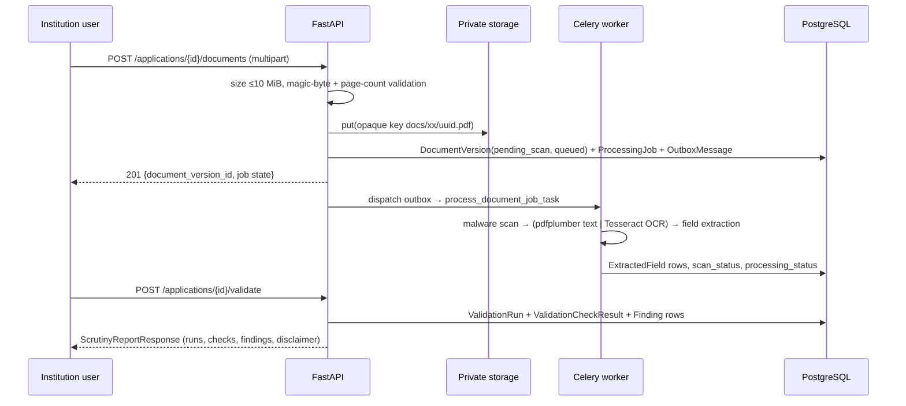

# Project Overview — AICTE Compliance AI

> **Audit basis.** This document describes the repository `rajaryan1111/aicte-compliance-ai`
> at branch `main`, commit `81d9667` (2026-10-30, merge of PR #17
> `hardening/regulatory-verification-governance`), plus the live deployments that the public
> URL currently talks to. Where the deployed system differs from the repository, that is
> stated explicitly — see [§7 Reality check](#7-reality-check-repository-vs-production).

---

## 1. What is AICTE Compliance AI?

**In one sentence.** A web application that lets a technical institution pre-check its
approval paperwork — which statutory documents are required, which were submitted, and which
have expired — before an AICTE Scrutiny Committee or Expert Visit Committee (EVC) looks at it.

It is **not** an AICTE portal, it does **not** issue approvals, and it does **not** verify
that a certificate is genuine. It is a checklist + validity-date comparison engine with a
regulatory reading aid and a faculty-cadre calculator attached.

### Plain-language version

An institution applying for Extension of Approval (EoA), a new programme, or an intake change
has to submit a long list of certificates: fire safety NOC, building occupancy certificate,
structural stability certificate, land title, affidavits, NBA accreditation, and so on. Two
things go wrong repeatedly:

1. **A required certificate is simply missing** from the upload set.
2. **A certificate is on file but has expired** (very common with fire NOCs and occupancy
   certificates).

Either one triggers a deficiency report, a hearing, and sometimes a reduction of approved
intake. This project lets a college coordinator type in the required list, the submitted list,
and the expiry dates, and get an immediate, evidence-cited list of what is missing or expired —
plus the AICTE clause that is implicated and a suggested mitigation undertaking.

### Technically precise version

The system is a React 19 single-page application talking to a FastAPI service. The public
comparison endpoint (`POST /api/v1/validate`) is a **pure function**: it receives
`required_documents[]`, `submitted_documents[]`, and `expiry_dates{}`, and returns
`status` (`preliminary_checks_passed` / `attention_required`), `missing_documents[]`,
`expired_documents[]`, and a `findings[]` array of structured records
(`MISSING_DOCUMENT`, `DOCUMENT_EXPIRED`) with `evidence` objects. Expiry is evaluated against
the **server's current UTC date**. Every response carries a `validation_scope` of
`caller_supplied_checklist_only` and a `notice` disclaiming regulatory authority.

A second, much larger backend surface exists in the repository — applications, immutable
document versions, malware scanning, OCR extraction, purged walk-forward validation runs,
review actions, cryptographic audit packages, issuing-authority verification adapters, and a
source-governed regulatory rule engine — but that surface is **not** what the public website
uses today (see §7).

---

## 2. What problem does it solve?

| Problem for the institution | What the product does | Evidence |
|---|---|---|
| Missing statutory document discovered only at scrutiny | Compares required vs submitted name lists and enumerates the gap | `POST /api/v1/validate` → `missing_documents[]` |
| Expired certificate discovered only at scrutiny | Compares supplied expiry dates with the server's UTC date | `DOCUMENT_EXPIRED` finding with `evaluation_date` |
| No explanation of *why* a gap matters | Maps findings to APH clauses, impact, and a mitigation undertaking | `frontend/app/src/lib/aicte-rules.ts` (`APH_CLAUSE_CATALOG`) |
| Faculty cadre/FSR shortfalls found late | 1:2:6 cadre + 1:15 / 1:20 FSR calculator with deficit register | `frontend/app/src/pages/CadreCalculatorPage.tsx` |
| No record of what was checked and when | Saved validation runs, CSV export, printable summary | `frontend/app/src/lib/report.ts`, `history-storage.ts` |
| Manual transcription errors from PDFs | PDF text extraction of expiry/issue dates, certificate number, issuing authority | `backend/app/document_analyzer.py` |

**What it deliberately does not solve.** It does not decide compliance. It cannot detect a
forged certificate, it cannot read a scanned image without Tesseract installed, and it
contains **no active AICTE rule** — the backend rule engine requires two-step human approval
before any rule can execute (`backend/app/rule_catalog.py`).

---

## 3. Who are its intended users?

| User | Role in the repo's RBAC | What they need |
|---|---|---|
| Institution coordinator / principal's office | `institution_admin` | Upload/collect certificates, pre-check, fix gaps before submission |
| AICTE scrutiny officer / regional office reviewer | `scrutiny_officer` | Triage queue, findings review, record review actions |
| Auditor / observer | `auditor` | Read-only access to runs, findings, audit packages |
| Regulatory director | `regulatory_director` | Verify rule sources and approve rules |
| Platform operator | `super_admin` | Everything, including retention and rule approval |

Roles and permissions are defined centrally in `backend/app/core/rbac.py` (5 roles,
12 permissions) and enforced server-side through `verify_institution_membership()`
(`backend/app/api/deps.py`), which returns **404** rather than 403 for foreign tenants to
avoid resource probing.

> **Practical note.** The UI only ever signs a user in as `institution_admin` or
> `scrutiny_officer` (derived from the username in `frontend/app/src/components/AuthContext.tsx`).
> There is no role-management screen.

---

## 4. Real-world use case

A private engineering college in Maharashtra is filing EoA for 2026–27. Its coordinator:

1. Opens the workspace and loads the "Engineering EoA 2024–27" scenario, or types the real
   checklist.
2. Lists the 5–8 required documents and the 3–6 actually available.
3. Enters expiry dates read off the certificates (or lets the PDF analyzer pre-fill them).
4. Runs validation; receives "2 missing, 1 expired", three findings, and a readiness estimate.
5. Sends the generated deficiency register to the principal, obtains the renewed fire NOC, and
   re-runs the check.
6. Optionally opens the Cadre & FSR calculator to check whether the department roster would
   survive a cadre review.

Verified example from the **live site** (synthetic data, 2026-10-30):

```
Institution: SYNTH-INST-001 · Application: eoa
Required (5): aicte_approval, mandatory_disclosure, land_use_certificate,
              fire_safety_certificate, building_occupancy_certificate
Submitted (3): aicte_approval, mandatory_disclosure, land_use_certificate
Expiry: aicte_approval=2024-03-31, fire_safety_certificate=2025-12-31
→ status: attention_required · 2 missing · 1 expired · 3 findings · readiness 40 %
```

---

## 5. Original problem statement

The repository documents the intent in `docs/canonical/prd.md` and `SIH_SUBMISSION.md`
(Smart India Hackathon problem statement **SIH26261**, AICTE). The canonical PRD's problem
framing is: institutions fail approval scrutiny on documentary and cadre deficiencies that are
detectable *before* submission, but checking is manual, inconsistent, and undocumented.

Two important caveats about the source material:

* The canonical docs in `docs/canonical/` are **stale relative to the code**. Several still
  assert "no frontend, no authentication, no persistence" while the tree contains all three.
  This audit treats the code and tests as authoritative and the docs as historical intent.
* The repository contains no copy of the original AICTE handbook PDF. Clause citations
  (`Clause 2.4`, `Annexure-2 §2.1(v)`, etc.) are transcribed into source files; they have
  **not** been machine-verified against an official document in this audit.

---

## 6. Complete workflow

```mermaid
flowchart TD
    A[User opens aicte-compliance-ai.vercel.app] --> B[Dashboard: scope notice + 4 modules]
    B --> C{Choose module}
    C -->|Validate| D[4-step wizard: Application → Documents → Expiry → Review]
    D --> E[POST /api/v1/validate]
    E --> F[Findings: MISSING_DOCUMENT / DOCUMENT_EXPIRED]
    F --> G[Results view: readiness, expiry matrix, findings table, CSV/print/dossier]
    G --> H{Sign in?}
    H -->|yes| I[Save run to history]
    H -->|no| J[Unsaved; view only]
    C -->|Cadre & FSR| K[Client-side 1:2:6 + FSR calculator]
    C -->|Audit History| L[Requires auth → saved runs list/detail]
    C -->|Compliance Guide| M[Static APH guidance, tracks, FAQ]

    subgraph Backend, repository scope only
      N[Applications / document versions]
      O[Malware scan → OCR/text extraction → findings]
      P[Rule engine: gate-approved rules only]
      Q[Audit packages + retention]
      N --> O --> P --> Q
    end
```

Step-by-step, for the public path:

1. **Context** — institution identifier + application type (`eoa`, `new_program`,
   `intake_change`).
2. **Documents** — required names and submitted names as free-text tags; duplicates rejected
   client-side after trimming.
3. **Expiry dates** — optional per-document dates; the PDF analyzer can pre-fill one.
4. **Final review** — read-back of everything, then `POST /api/v1/validate`.
5. **Result** — status banner, counts, required-list comparison, findings table with evidence,
   readiness estimate, expiry timeline, CSV export, printable summary, JSON dossier.
6. **History** (optional) — requires a session; stored client-side and, if the API supports it,
   server-side.

The repository's richer backend workflow (used by the enterprise API, not by the public UI):



---

## 7. Reality check: repository vs production

This is the single most important section for anyone presenting or maintaining the project.
Three different artifacts exist, and **they are not the same code**:

| Artifact | What it is | Verified evidence |
|---|---|---|
| **Repository `main` @ `81d9667`** | 50 API routes, 20 DB tables, 9 migrations, `version="0.3.1"` string, full enterprise backend + React app with 9 routed paths (6 public pages, sign-in, history list/detail) | Local OpenAPI dump; `pytest` 474 passed / 21 skipped / 1 failed (reproduced 2026-10-30 in a clean 3.12 venv) |
| **Public frontend** `aicte-compliance-ai.vercel.app` | Working SPA, but built from a **different source revision**: it contains a `/vault` "Document Vault" screen that does not exist anywhere in this repository's history | Bundle `index-D0Wiwpzv.js`; `git log -S'Document Vault'` returns no commit |
| **Public backend** `aicte-compliance-backend-live.vercel.app` | A *different, smaller* FastAPI app: **11 routes**, `version 0.4.0`. Has `/validate`, `/documents/analyze`, the vault and **auth-gated** history; has **no auth endpoint** and no enterprise routes | `GET /openapi.json`; `/documents/analyze` → 200; `/documents` → 401; `/auth/token` → 404 |
| **Render backend** `aicte-compliance-api-preview.onrender.com` | 29 routes, `version 0.3.1`, Postgres ready, migration `g7b8c9d0e1f2` (two migrations behind repo). Enterprise core only: **no** `/validate` prototype helpers, no analyze, no seed, no compliance rules. JSON login exists but the documented demo credentials return 401 | `/health/ready`; `/openapi.json`; `POST /auth/token` (JSON) → 401 |

So statements such as "Backend: Render" describe *a* deployment, but **not the one the public
website calls**. The live site calls the Vercel backend. Neither live backend matches
`main`. Exact diffs:

* Repo has, live Vercel backend lacks: `/api/v1/auth/*`, `/api/v1/applications/*`,
  `/api/v1/compliance/*`, `/api/v1/seed`, `/api/v1/institutions`, `/api/v1/reviews/queue`,
  and the `/api/v1/applications/{id}/documents/*` version tree.
* Live Vercel backend has, repo lacks: top-level `GET/POST /api/v1/documents` (vault upload/list)
  and `GET /api/v1/documents/{document_id}/download`. Its analyze response also uses a
  different schema (`extracted_text` + `fields{}` instead of the repo's
  `extracted_text_preview` + flat `candidate_fields{}`), which this repository's UI cannot read.
* Render backend has, repo lacks: nothing — it is a strict subset (29 of 50 routes), and its
  `/api/v1/validation-runs` family is in-process memory only.

**Consequence.** Anyone documenting or demoing must say *which* deployment they mean. The
repository is the more capable and better-tested system. The public URL runs a different,
narrower build: its validation and PDF-analysis calls succeed, but its vault and history calls
return `401` because no auth endpoint exists on its backend, and the analyzer's response shape
does not match this repository's client.

---

## 8. Why it beats manual compliance checking

| Dimension | Manual spreadsheet | This prototype |
|---|---|---|
| Missing-document detection | Depends on human memory of the checklist | Deterministic set difference, same result every run |
| Expiry detection | Date-by-date eyeballing | Server-side UTC date comparison, per-document finding with evidence |
| Consistency | Varies by officer | Same input → same output; `checked_at` + `source` recorded |
| Traceability | Email threads | Structured findings, CSV export, JSON dossier, printable summary |
| Speed | Minutes to hours per application | Sub-second comparison |
| Cadre/FSR math | Error-prone | Deterministic 1:2:6 and intake×duration÷FSR arithmetic with deficit register |
| Honesty about scope | Implicit | Product refuses to claim compliance; `validation_scope` and `notice` on every response |

**What it does not beat manual checking on:** authenticity, content correctness, scanned
documents without OCR, and legal interpretation. Those remain human work by design.

---

## 9. Non-negotiable boundaries the product states about itself

These are not disclaimers bolted on for show; they are enforced in code or content:

1. `validation_scope = "caller_supplied_checklist_only"` — the API never loads an official
   checklist (`backend/app/main.py`).
2. `source = "synthetic_demo_input"` on the comparison response.
3. The rule engine ships **zero active rules**; activation requires verified provenance,
   an approval record, and four test categories (`backend/app/rule_catalog.py`).
4. The Cadre page states its ratios are "illustrative, configurable assumptions… No AICTE rule
   is active in this prototype."
5. The Compliance Guide states the content is "not verified current official policy."
6. The Privacy page is explicitly a draft and is **currently out of date** — see
   [SECURITY_AND_PRIVACY.md](SECURITY_AND_PRIVACY.md).

---

## 10. One-paragraph summary for a non-technical reader

AICTE Compliance AI is a checking tool, not an approval system. A college types in the list of
certificates AICTE asks for, the list it actually has, and the expiry dates. The tool instantly
lists what is missing and what has lapsed, cites the handbook clause behind each gap, suggests
the undertaking that usually fixes it, and can estimate how far the department's faculty numbers
are from the required 1:2:6 cadre ratio. It saves the check for later review and exports it.
It says clearly, everywhere, that a passing result is not AICTE approval.
