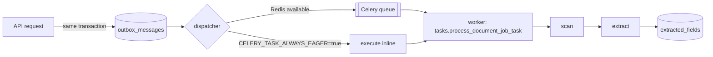

# Technical Architecture

Audited from `main` @ `81d9667` plus live inspection of the deployments on 2026-10-30.

---

## 1. Stack

### Frontend

| Concern | Choice | Version |
|---|---|---|
| Build tool | Vite | ^8.3.4 |
| UI | React + React DOM | ^19.3.1 |
| Routing | `react-router-dom` (client-side SPA) | ^7.18.4 |
| Styling | Tailwind CSS v4 via `@tailwindcss/vite` | ^4.3.3 |
| Components | Hand-rolled primitives + `class-variance-authority`, `clsx`, `tailwind-merge` | — |
| Icons | `lucide-react` | ^1.61.0 |
| Optional auth | `@supabase/supabase-js` | ^2.118.0 |
| Language | TypeScript | ~6.0.3 |
| Lint | `oxlint` | ^1.88.0 |
| Tests | `node --test` on `frontend/tests/*.test.mts` | — |

Built bundle (verified): `index-*.js` ≈ **540.9 kB** (169.5 kB gzip), CSS ≈ **60.5 kB** (10.4 kB
gzip). No code splitting — one chunk for the whole app.

### Backend

| Concern | Choice | Version |
|---|---|---|
| Framework | FastAPI (`fastapi[standard]`) | 0.161.0 |
| Validation | Pydantic v2 | 2.14.1 |
| ORM | SQLAlchemy 2.x | ≥2.0,<3.0 |
| Migrations | Alembic (9 revisions, head `i9d0e1f2a3b4`) | ≥1.13,<2.0 |
| DB driver | `psycopg2-binary` | ≥2.9 |
| PDF | `pdfplumber` | ≥0.11,<1.0 |
| Auth | `PyJWT` (HS256) + `bcrypt` | ≥2.8 / ≥4.0 |
| Async work | Celery + Redis (or eager mode) | ≥5.3 / ≥5.0 |
| Multipart | `python-multipart` | ≥0.0.9 |
| Optional OCR | `Pillow`, `pytesseract` (separate file) | 11.3.0 / 0.3.13 |
| Python | CI uses **3.12**; code uses `X | None` syntax (≥3.10) | — |

There is **no** `pandas`, `numpy`, `scikit-learn`, `transformers`, or LLM SDK in the backend
requirements. Nothing in this project trains or loads a model.

---

## 2. Actual architecture

```mermaid
flowchart TB
    subgraph Client["Browser (React SPA)"]
        R[react-router]
        P[Dashboard / Validate / Cadre / History / Guide]
        L[lib/api.ts fetch layer<br/>15 s timeout, discriminated result]
        AU[AuthContext<br/>sessionStorage]
        HS[history-storage<br/>localStorage fallback]
        R --> P
        P --> L
        P --> AU
        P --> HS
    end

    subgraph Edge["Vercel"]
        ST[Static bundle + SPA rewrite<br/>all paths → /index.html]
    end

    subgraph BE1["Live backend · Vercel · v0.4.0"]
        B1[11 operations]
        B1v[/validate · /documents/analyze<br/>auth-gated vault + history<br/>no auth endpoint]
    end

    subgraph BE2["Render · v0.3.1 · 29 routes"]
        B2[FastAPI app]
        PG[(Managed PostgreSQL)]
        FS[(Private local storage dir)]
        B2 --- PG
        B2 --- FS
    end

    subgraph BE3["Repository target · 50 routes"]
        B3[FastAPI app]
        AUTH[JWT + RBAC 5 roles/12 perms]
        ORCH[Validation orchestration<br/>8 check families]
        RULE[Rule registry<br/>gate-approved only]
        CEL[Celery worker / outbox]
        SCAN[ClamAV adapter<br/>fail-closed]
        OCR[pdfplumber / Tesseract]
        DB3[(PostgreSQL 20 tables)]
        AUD[(Audit events + packages)]
        B3 --> AUTH --> ORCH --> RULE
        CEL --> SCAN --> OCR --> ORCH
        ORCH --> DB3
        ORCH --> AUD
    end

    Client -->|HTTPS| Edge
    Edge -->|"writes/reads static"| ST
    P -.->|"in production: DEFAULT_PROD_API_BASE"| B1
    P -.->|"VITE_API_BASE_URL if configured"| B2
    B3 -.->|"not deployed"| Client
```

Solid arrows are live. Dotted arrows are configuration-dependent or absent.

**Reading the diagram correctly matters.** The deployed website does **not** call the Render
service shown in `render.yaml`. `lib/api.ts` defaults to
`https://aicte-compliance-backend-live.vercel.app` when `VITE_API_BASE_URL` is unset at build
time, and that is a different FastAPI app (11 routes) which lacks authentication. The Render
service exists, is healthy, and has Postgres — but nothing points the public UI at it.

---

## 3. Deployment topology (verified)

| Layer | URL | Runtime | Observed |
|---|---|---|---|
| Frontend | `aicte-compliance-ai.vercel.app` | Vercel static + SPA rewrite | Loads; calls the Vercel backend |
| Live backend | `aicte-compliance-backend-live.vercel.app` | Serverless Python | `GET /health` ok, `version 0.4.0`, 11 operations; `/validate` and `/documents/analyze` succeed, `/documents` and `/validation-runs` return 401, `/auth/token` 404 |
| Render backend | `aicte-compliance-api-preview.onrender.com` | Render free web service, uvicorn | 29 operations, `version 0.3.1`, Postgres reachable; enterprise core only (no analyze/seed/saved-runs/compliance); JSON token endpoint |
| Database | Render managed Postgres (`aicte-db`) | Postgres | `/health/ready` reports `database: ready`, migration `g7b8c9d0e1f2` |

`render.yaml` provisions: one free Python web service (Oregon), build =
`pip install -r backend/requirements.txt && python -m alembic -c backend/alembic.ini upgrade head`,
start = `uvicorn backend.app.main:app --host 0.0.0.0 --port $PORT`, plus a free Postgres
instance. Secret: `JWT_SECRET_KEY` generated by Render. Free plan sleeps after idle, so the
first request after a pause can take tens of seconds.

**Schema drift.** Render's applied migration is `g7b8c9d0e1f2`; the repository head is
`i9d0e1f2a3b4`, two revisions later (verification records, rule approvals, retention). The
Render database therefore lacks tables the current code expects; any deploy of `main` there
must run the outstanding migrations first.

**Frontend/backend revision mismatch.** The public bundle contains a `/vault` screen absent
from this repository (no commit, no file), and the live backend exposes matching vault routes
(`GET/POST /api/v1/documents`) absent from this repository too. The live analyzer also returns
a different JSON schema than the repository's. Two possibilities: the deployment was built from
an unmerged branch, or from another repository. Either way the public site is **not
reproducible from `main`** until that source is located and merged.

**Render is not `main` either.** It reports `0.3.1` with 29 operations and a JSON-login schema —
a revision between the deployed frontend backend and the current repository.

---

## 4. Request path (public validation)

```
Browser
  └─ ValidatePage (4-step wizard)
       ├─ lib/form-validation.ts        per-step + whole-request checks
       ├─ lib/api.ts :: validateDocuments()   15 s AbortController
       │    └─ POST {API_BASE}/api/v1/validate
       │         └─ CORS: allow_origin_regex https://.*\.vercel\.app
       │              + explicit origins + CORS_ALLOWED_ORIGIN
       └─ Pydantic ValidationRequest → set arithmetic → ValidationResponse
```

Frontend dev proxy (`vite.config.ts`) forwards `/api` and `/health` to
`http://127.0.0.1:8000`, so `VITE_API_BASE_URL=""` works locally without CORS.

---

## 5. Background processing



* The **outbox** guarantees a job is not lost if enqueueing fails: the message commits with the
  document version, and the dispatcher retries.
* `CELERY_TASK_ALWAYS_EAGER=true` on Render means "synchronous" processing inside the request —
  fine for a prototype, dangerous for large uploads (request timeout) and it removes the
  queue's isolation.
* `processing_jobs` tracks attempts/state; `retry_wait` is a real state.
* No cache layer (no Redis cache, no CDN API cache). Redis is only a broker.

---

## 6. Configuration (names only, never values)

### Backend

| Variable | Required | Purpose / default |
|---|---|---|
| `DATABASE_URL` | prod | Postgres DSN; defaults to `sqlite:///./aicte_dev.db` |
| `JWT_SECRET_KEY` | **yes for auth** | HS256 signing key, must be ≥32 chars or startup raises |
| `ENVIRONMENT` | no | `production` disables demo endpoints |
| `ENABLE_DEMO_ENDPOINTS` | no | defaults true in dev, false in prod |
| `CORS_ALLOWED_ORIGIN` / `CORS_ALLOW_ORIGINS` | no | comma-separated extra origins |
| `CELERY_BROKER_URL` / `REDIS_URL` | no | broker DSN |
| `CELERY_TASK_ALWAYS_EAGER` | no | run tasks inline |
| `STORAGE_LOCAL_DIR` | no | private storage root |
| `CLAMAV_HOST`, `CLAMAV_PORT` | no | scanner daemon |
| `ALLOW_DEV_MOCK_SCANNER` | no | explicit dev-only bypass |
| `TESSERACT_LANGUAGE`, `TESSERACT_MAX_BYTES` | no | OCR tuning |
| `DIGILOCKER_API_KEY`, `DIGILOCKER_SANDBOX`, `DIGILOCKER_BASE_URL` | no | issuing-authority adapter |
| `STATE_FIRE_PORTAL_URL`, `UNIVERSITY_PORTAL_URL` | no | issuing-authority adapters |
| `ALLOWED_AUTHORITY_DOMAINS`, `ALLOWED_AUTHORITY_HOSTS`, `ALLOW_INSECURE_AUTHORITY_ENDPOINTS` | no | SSRF allowlist |
| `RETENTION_QUARANTINE_DAYS`, `RETENTION_JOB_DAYS`, `RETENTION_SCHEDULE_INTERVAL_SECONDS` | no | retention defaults (30/14/86400) |
| `ENABLE_INPROCESS_RETENTION_SCHEDULER` | no | dev scheduler |
| `PYTHONPATH`, `PORT` | Render | platform |

### Frontend (build-time, public by design)

| Variable | Purpose |
|---|---|
| `VITE_API_BASE_URL` | backend origin; empty = same-origin/proxy |
| `VITE_SUPABASE_URL` | optional Supabase project |
| `VITE_SUPABASE_PUBLISHABLE_KEY` | optional Supabase anon key (public) |

**Security note.** Anything prefixed `VITE_` is compiled into the public bundle. Never place a
secret there. None currently is; the Supabase key is the publishable/anon key.

---

## 7. Error handling and logging

**Frontend.** Every API call returns a discriminated union `{ok:true,data} | {ok:false,kind,
status,errors,raw}` with `kind ∈ network|timeout|server|validation|invalid_response`. UI shows
inline alerts; CSV export failures are caught and surfaced; 401 triggers re-auth. There is no
global error boundary and no client-side error reporting (no Sentry or equivalent).

**Backend.**
* Pydantic produces 422 with field paths.
* Domain errors are `HTTPException` with explicit status (400/401/403/404/409/413/422/500).
* `ValidationOrchestrationService` wraps execution in try/except, rolls back, records a `failed`
  run with a limitation string, and returns it rather than raising to the client.
* Per-rule evaluation exceptions are isolated so one bad rule cannot fail the run.
* Logging is stdlib `logging` (`logger.exception`, `logger.warning`). **No structured logging, no
  request IDs, no correlation IDs, no APM, no metrics endpoint.** Debugging production means
  reading Render logs.

---

## 8. CI

`.github/workflows/*.yml` defines:

| Job | What it does |
|---|---|
| `backend-tests` | Python 3.12, installs dev requirements, `pytest -q`, `pytest -q ai/tests`, `python frontend/tools/verify_fixtures.py` |
| `optional-ocr-integration` | installs `tesseract-ocr` + OCR requirements, runs the OCR engine integration test |
| `real-infrastructure-integration` | integration tests against real infrastructure adapters |

Because CI installs Tesseract, OCR tests pass there; a developer machine without the binary
sees one failure. That asymmetry explains the "474 passed, 21 skipped, 1 failed" local result.

**Gap.** There is no frontend build/test job, no Alembic migration check, and no deployment
trigger from `main` — the public site is not deployed by this workflow.

---

## 9. Local development

```bash
# backend
pip install -r backend/requirements-dev.txt
python -m alembic -c backend/alembic.ini upgrade head   # from the repository root
uvicorn backend.app.main:app --reload --port 8000

# frontend (separate shell)
cd frontend/app && npm ci && npm run dev   # http://localhost:5173
```

`JWT_SECRET_KEY` must be exported (≥32 chars) for any auth route; SQLite is the default DB.
The Vite proxy removes the need for CORS locally.

---

## 10. Architectural strengths and weaknesses

**Strengths**

* Deterministic core: the validation endpoint cannot drift between runs.
* Honest contracts: `validation_scope`, `source`, `notice`, `limitations` are part of the API
  schema, not optional prose.
* Provenance built into the schema: `consumed_version_ids`, `rule_snapshot`, SHA-256 per
  version, audit events.
* Fail-closed security gates (scanner, rule activation).
* Clean separation of extraction (advisory) from evaluation (deterministic).

**Weaknesses**

* Three divergent deployments from one repository; no reproducible release artifact.
* No UI for ~70 % of backend capability (applications, reviews, audit packages, retention).
* No queue observability, no metrics, no tracing.
* Single 540 kB JS chunk; no lazy routes.
* Schema drift between Render and `main`.
* Auth is effectively unusable in production (missing token route on the live backend).

---

## 11. What to build next, in architecture terms

1. **One deployment, one revision.** Pin the frontend build to the backend revision; deploy
   `main` to Render with `VITE_API_BASE_URL` set (or move the API to the same origin).
2. **Finish auth in production** (token route + seeded admin, or retire Supabase path).
3. **Expose the enterprise API** through an authenticated workspace UI.
4. **Observability**: request IDs, structured JSON logs, `/metrics`.
5. **Migration gate** in CI (`alembic upgrade head` on a throwaway Postgres) and a frontend
   build job.
6. **Delete or merge the vault screen** so the deployed UI matches the repository.
